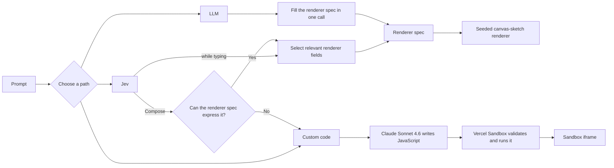

# Make abstract art programmatically with natural language

[Live demo](https://jev-abstract-art.vercel.app) · Built with [canvas-sketch](https://github.com/mattdesl/canvas-sketch), Jev, Vercel AI Gateway, and Vercel Sandbox.

Generate an abstract art idea in three ways, and compare the fidelity, speed, tokens, and cost.

## How generation works



### How Jev evaluates a characteristic

For the prompt **“a quiet blue gradient,”** Jev might return:

| Type | Characteristic | Probability distribution | Result |
| --- | --- | --- | --- |
| **Choice** | Field intent | `GRADIENT .72` · `GRADIENT_AND_MARKS .20` · `MARKS .05` · `SOLID .03` | Select `GRADIENT` with 72% confidence |
| **Score** | Motion importance | `irrelevant .65` · `supporting .25` · `important .08` · `essential .02` | Weighted score `0.47`; 65% confidence |

Choice uses the highest-probability option. Score uses the probability-weighted mean, here `(0×.65) + (1×.25) + (2×.08) + (3×.02) = 0.47`; the largest bucket is reported as confidence. Relevance scores below `1.5` are omitted, so this example does not ask for motion details.

| Path | What it does | Best for |
| --- | --- | --- |
| **Jev** | Updates only the relevant renderer fields as you type. On Compose, Jev checks whether the fixed renderer is expressive enough and reroutes when it is not. | Fast, live abstract-art iteration |
| **LLM** | Fills the complete renderer spec in one structured call, then uses the same seeded renderer as Jev. | Comparing general models on identical constraints |
| **Custom code + Sandbox** | Generates prompt-specific JavaScript, validates and runs it in Vercel Sandbox, then displays the result in an isolated iframe. | Scenes, interaction, or behavior beyond the renderer spec |

## Run locally

```bash
npm install
cp .env.example .env.local
npm run dev
```

Set `AI_GATEWAY_API_KEY` in `.env.local`. To enable local Sandbox previews, also run:

```bash
vercel link
vercel env pull
```

## Verify

```bash
npm test
npm run build
```
