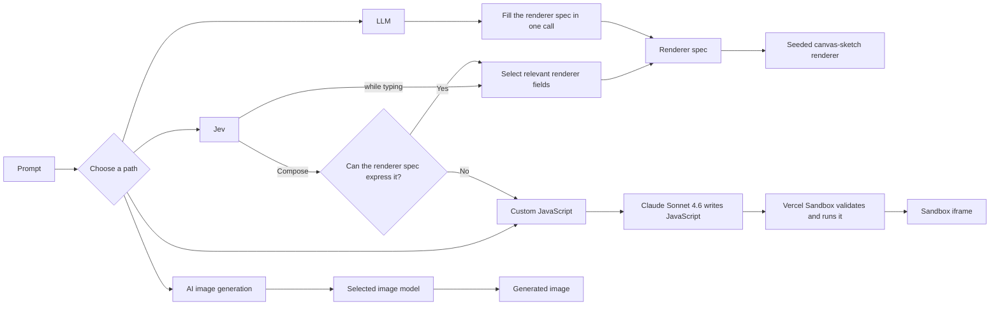

# Jev as a fast, consistent artist: a playground

[Live demo](https://jev-abstract-art.vercel.app) · Built with Jev, [canvas-sketch](https://github.com/mattdesl/canvas-sketch), Vercel AI Gateway, and Vercel Sandbox.

An abstract art playground built to showcase how quickly and consistently Jev turns ideas into abstract art through parallel, structured decisions across 80+ renderer characteristics. Compare four generation paths by fidelity, speed, tokens, and cost: two populate the same renderer spec, one generates custom JavaScript, and one provides a direct prompt-to-image baseline.

## How generation works



### How Jev evaluates a characteristic

For the prompt **“a quiet blue gradient,”** Jev might return:

| Type | Characteristic | Probability distribution | Result | What it means |
| --- | --- | --- | --- | --- |
| **Choice** | Field intent | `GRADIENT .72` · `GRADIENT_AND_MARKS .20` · `MARKS .05` · `SOLID .03` | Select `GRADIENT` with 72% confidence | Use the gradient-only rendering path and omit mark-layer fields. |
| **Score** | Motion importance | `irrelevant .65` · `supporting .25` · `important .08` · `essential .02` | Weighted score `0.47 / 3`; 65% confidence | `0.47` is below the `1.5` relevance cutoff, so omit the `motion`, `tempo`, and `rhythm` fields and keep the artwork still. |

Choice uses the highest-probability option. Jev returns probabilities over the ordered Score tiers, and the score is their weighted mean: `(0×.65) + (1×.25) + (2×.08) + (3×.02) = 0.47`. This app displays the largest tier probability, `65%`, as confidence. Relevance scores below `1.5` are omitted (50% since there's 4 levels of importance), so this example does not ask for motion details.

| Path | What it does | Best for |
| --- | --- | --- |
| **Jev** | Updates only the relevant renderer fields as you type. On Compose, Jev checks whether the fixed renderer is expressive enough and reroutes when it is not. | Fast, live abstract-art iteration |
| **LLM** | Fills the complete renderer spec in one structured call, then uses the same seeded renderer as Jev. | Comparing general models on identical constraints |
| **Custom JavaScript + Sandbox** | Claude Sonnet 4.6 generates a prompt-specific renderer, which Vercel Sandbox validates and runs in an isolated iframe. | Scenes, interaction, or behavior beyond the renderer spec |
| **AI image generation** | Sends the prompt directly to an image model and displays the generated pixels without canvas-sketch or the renderer spec. Defaults include GPT Image 2.5 Flare, Recraft V4.1 Flash, FLUX 3 Image, and Muse Image 1.0. | A non-programmatic prompt-to-image baseline |

## Run locally

```bash
npm install
cp .env.example .env.local
npm run dev
```

Set `AI_GATEWAY_API_KEY` in `.env.local`. To enable local Sandbox previews, also run:

```bash
vercel link
vercel env pull
```

## Verify

```bash
npm test
npm run build
```
